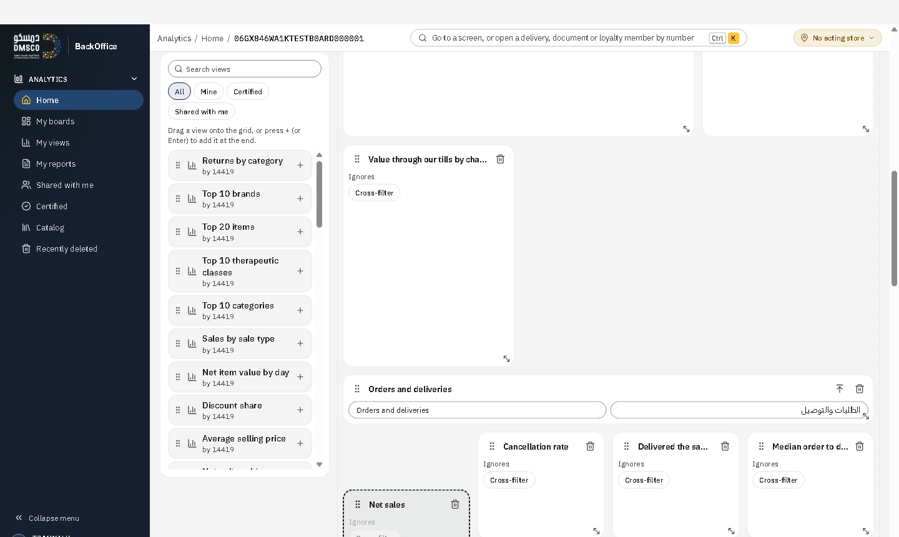
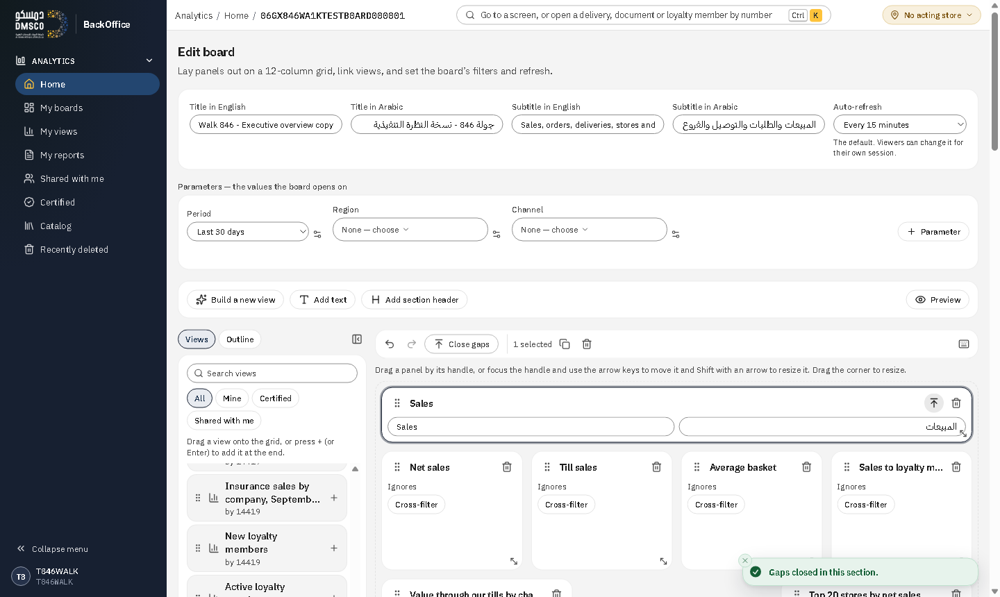
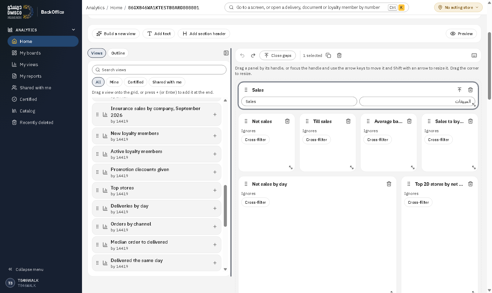

# 846 — Smoother drag and drop, close gaps, and roomier side lists in the board editor and the report designer

## Why

After using 837 the owner said:

- Dragging is quirky. On a long board, dragging a section or view down makes the page jump to the end instead
  of scrolling slowly enough to choose where to drop.
- After adding a view from the list and deleting it, an empty space stays, and every panel below must be moved
  up one by one. The owner wants a BUTTON for this, not automatic compaction: the space may be wanted for
  something else.
- The views list is too narrow to read the names. They want a resizable splitter.
- "What else can we enhance?" They asked for the same in the report designer, and for research into how Figma
  and similar tools handle this (research file above).

## Shared pieces (built first, in `core/ui`)

- `core/ui/auto-scroll.ts` (+test): `edgeSpeed` is the speed curve. It scrolls only inside a ~96 px band at
  each edge, faster the deeper the pointer is, reaching full speed before the edge, and it ramps up over a hold.
- `core/ui/use-auto-scroll.ts`: `useAutoScroll(targetRef, onScrolled)` returns `{ follow(x, y), stop() }`. It
  runs a frame loop on the element that scrolls the target, and calls `onScrolled(pointer)` after each scroll so
  the drop cell can be worked out again.
- `core/ui/inspector-pane.ts`: `PaneBounds`, and `separatorKeyWidth(..., { bounds, edge })`.
- `core/ui/PaneSeparator.tsx`: `bounds` and `edge` props, and `useRememberedPaneWidth(key, bounds)`.

## What to build

### Board editor
1. **Auto-scroll.** Pointer move, pointer resize and the palette's HTML5 drop all use `useAutoScroll`. The cell
   is worked out again on scroll, and nothing else scrolls the page during a drag.
2. **Close gaps.** A toolbar button, plus one on each section header's tools for "this section only". It moves
   panels up to fill empty rows (vertical compaction). Order is kept, so a section's panels stay under its
   header. Deleting a panel never closes gaps by itself. It is one undo step. When there is no gap, it says so.
3. **Resizable views list.** Use `PaneSeparator` with `edge="end"`; the width is remembered. The list can be
   collapsed to a thin rail and opened again. Truncated names show in full on hover, and rows wrap to two lines.
4. **Undo / redo** for the layout and fields: Ctrl+Z, Ctrl+Y and Ctrl+Shift+Z, with toolbar buttons. One step
   per finished gesture: a whole drag, not every cell it passed. The existing AI undo becomes one step of it.
5. **Live preview while dragging.** The other panels reflow as the drag goes (already partly so). A ghost shows
   the dragged panel's place. Esc cancels the drag and puts everything back.
6. **Keyboard.** On a focused panel, Delete removes it and Ctrl+D duplicates a view, text or section panel into
   the first free slot below it. Esc clears the selection. `?` opens a small shortcut sheet.
7. **Outline to jump (item 9).** A compact list of panels, sections first, beside the views list or as a tab
   in it. Clicking an entry scrolls the panel into view and focuses it. Multi-select: Ctrl or Shift-click
   panels to select several, then move them together with the arrows, Delete them, or Align left / top and
   make them the same width.

### Report designer
1. **Auto-scroll** for its section and block drag.
2. **Drop indicator line.** A thin primary-coloured line at the nearest edge of the hovered block or section,
   instead of a before/after guess. A drop that is not allowed shows no line.
3. **Resizable outline and inspector panes,** using `PaneSeparator`, with remembered widths. Truncated names show
   in full on hover.
4. **Views list.** The same views palette (search, chips, folder) as a tab or collapsible list. Drag a view into
   a section at the indicator line, or press "+" to add it to the selected section.
5. **Keyboard.** Delete removes the selected block; Ctrl+D duplicates it; Esc clears the selection.

## Proof

- [x] pure: `edgeSpeed`, separator keys with bounds and edge, `closeGaps` (all and one section, order kept,
      no-op), undo history (one step per gesture), duplicate placement, nearest-edge indicator · unit
- [x] drive (stub): a long board drag scrolls gradually; Close gaps; resize the list; undo/redo; Esc cancels;
      report indicator line and dragging a view into a section · flow (stub)
- [x] live on the local rig: the owner's Executive overview · flow (live)

## Boundaries

- Client only; no server change.
- No new npm dependency. The splitter and auto-scroll are hand-rolled in `core/ui`.

## Comments

### 2026-11-07 — board editor half (items 1–7) built, stub drive green

- **What caused the jump.** The browser's *scroll anchoring*. As the held panel reflowed the rows above the window,
  Chromium moved the page to keep some panel still, which piled 3–4 px/ms jumps on top of the auto-scroll. The fix is
  `overflow-anchor: none` on the editor grid. With it, the drive measures 0.2–0.9 px/ms, ramping up, under full speed.
- **Pure, with tests first.** `layout.ts` has `closeGaps` (whole board or one section), `sectionOf`, `freeSlotBelow`,
  and the reducer actions `closeGaps`, `duplicate`, `nudgeMany`, `removeMany` and `align` (start, top, width).
  `settle` now takes several fixed panels. The new `board-history.ts` holds the checkpoint history (gesture, typing
  coalesce, rebase), `outlineOf` and `copyBindings`. Tests: layout +12 (39), board-history 9.
- **UI.** `BoardEditorGrid` gets `useAutoScroll`, recomputing the cell on scroll for both the pointer drag and the
  palette drop. The held panel is drawn as a ghost, and Esc cancels the drag. It also gets selection
  (Ctrl/Shift-click), Delete, Ctrl+D, group arrows, and a "Close gaps in this section" button on each header.
  `BoardEditor` gets the toolbar (Undo, Redo, Close gaps, selection actions, shortcuts), Ctrl+Z, Ctrl+Y, Ctrl+Shift+Z
  and `?`. The AI step's Undo is now a history step. New `BoardEditorSide` holds the Views and Outline tabs, the
  resizable width (remembered) and the fold-to-rail. New `BoardShortcuts` is the shortcut sheet. `ViewsPalette` rows
  wrap to two lines, show the full name on hover, and take a new optional `heading` prop.
- **Ruled.** Section Close gaps moves only that section's panels. The room freed at the section's end stays until the
  whole-board button closes it. A duplicate goes to the first slot *below* the source, from its bottom row down,
  trying its own column first. "Same width" uses the first panel picked. "Align left" is the inline start, so it is
  the right edge under Arabic. Ctrl+Z inside a text field stays the field's own undo.
- **Drive.** `DRIVE_ONLY=846` gives 68/68 (en and ar). The 777, 836 and 837 scenarios still pass, apart from the known
  `buildsNewView`. Not driven: auto-scroll during a palette (HTML5) drag, because Playwright's emulated native drag
  drops when the page scrolls. It goes through the same hook.

### 2026-11-07 — Comments — report half (designer items 1–5) built, stub drive green

- **Pure, with tests first.** New `report-drop.ts` (+test, 15): `slotAmong` (the gap nearest the pointer among
  stacked boxes), `blockDrop` / `sectionDrop` (`null` = no line: the wrong kind, or the item's own place), and
  `lineEdge` (which item draws the line, and on which edge). `report-ops` adds `duplicateBlock` (just after itself,
  bindings copied, summary refused) and an optional `index` on `addBlock`. report-ops +4 tests.
- **UI.** The drag goes by the gap: a 2 px primary line on the nearest edge of one block or section, shown on the page
  and in the outline, and none for a disallowed drop. The drag is held in a ref and `dragenter` counts as an over too,
  so a short move still draws the line. During a drag `useAutoScroll` drives the page, or the outline when the
  pointer is in it. The outline and inspector are resizable, `PaneSeparator` `edge="end"` / default, 256 / 416 px,
  each width remembered. Outline rows show their full name on hover. The outline column has Outline · Views tabs.
  The Views tab is `ViewsPalette`: drag a view to the line, or "+" adds it to the selected section (or the selected
  block's section, else the last one), read whole and copied as "Copy a saved view" does. Delete removes the selected
  block, Ctrl+D duplicates it and Esc clears the selection. Each is one step, and none fires in a text field or with
  a dialog open.
- **Drive.** `tools/report-designer-846-drive.mjs` gives 80/80 (en and ar), and `DRIVE_ONLY=828,829,831` 216/216.
- **Open.** The palette's own hint says "onto the grid" in the designer. It needs an optional hint prop on
  `ViewsPalette` (board-owned). Clicking a block on the page does not select it; the edit tool or the outline does.

**2026-11-17 - test run on main 7daac778.** Unit: the same vitest run (79 files, 1,104 tests, all pass, `auto-scroll` and `layout` included). Stub: `DRIVE_PORT=5173 node tools/report-designer-846-drive.mjs` 80/80 PASS, LTR and RTL (gradual edge scroll, the drop line, Views tab, "+" add, Delete/Undo, Ctrl+D, Esc, no page errors). That is the report-designer half of the stub box only; no drive covers the board half (long board drag, Close gaps, resizing the list), so the stub box stays open, as does the live box (the owner's Executive overview).

### 2026-11-17 — stub drive and live walk: done

- **Correction to the note above.** The board half does have a stub drive: `dragAndGaps846` in
  `tools/analytics-drive.mjs`. The earlier note missed it.
- **Stub, on main 698e19a9 code (the dev server's analytics code is the same).**
  - `DRIVE_PORT=5173 DRIVE_ONLY=846 node tools/analytics-drive.mjs`: 68/68, en and ar. It covers the long
    board drag scrolling gradually, the ghost, Esc, a drag as one undo step (buttons and Ctrl+Z / Ctrl+Y /
    Ctrl+Shift+Z), section and board Close gaps, "no gaps", the list splitter (keys, pointer, remembered), the
    rail, the outline, Ctrl+D, Delete, Align top and `?`.
  - `DRIVE_PORT=5173 node tools/report-designer-846-drive.mjs`: 80/80, en and ar (the indicator line, a view
    dragged into a section, "+", Delete, Ctrl+D, Esc).
- **Live, on the local rig** (SIS.Api pricing2 walk build, local POS_Server). A throwaway user `T846WALK` with
  `ANALYTICS_VIEWER` edited a personal copy of the owner's shared "Executive overview" (22 panels, 3 sections,
  29 rows). The owner's two boards were not touched, and the copy was never saved.
  - **Long drag.** Holding "Net sales" in the bottom band scrolled the page gradually: 0.23 to 0.86 px/ms,
    under full speed, ramping up, and 853 of 2,882 px after about a second. The held panel followed to row 13 as
    a ghost. Esc put all 22 panels back. 
  - **Undo and redo.** A drag four columns over was one undo step, through the buttons and through
    Ctrl+Z / Ctrl+Y.
  - **Close gaps.** Removing the sales line left its gap. The section's Close gaps moved "Value through our tills
    by channel" up from row 7 to row 3, and left the next sections alone ("Gaps closed in this section"). The
    toolbar's Close gaps then moved the Orders section up from row 11 to row 7, keeping the reading order. A
    second press said "There are no gaps to close.", and three Undos went back step by step to the start.
    
  - **Views list.** It went from 272 to 320 px with the keys and to 420 px with the pointer, and the width was
    remembered. It folded to a rail and reopened at 420. 
  - **Outline and keys.** The outline listed all 22 panels. Clicking the note scrolled it into view and focused
    it. Ctrl+D put the copy in the free slot below it (0,24 → 0,29), Delete removed it, and `?` opened the
    shortcut sheet. The board ended identical to how it started.
- **Rig note, not 846.** On this rig two menu access probes are slow when signed in: `StoreStage/Access` took
  about 8 s and `SdDocumentWeb/Access` about 17 s. With about 40 probes behind the browser's 6 connections, a
  fresh sign-in waits roughly a minute on "Checking your access…" before analytics answers.
